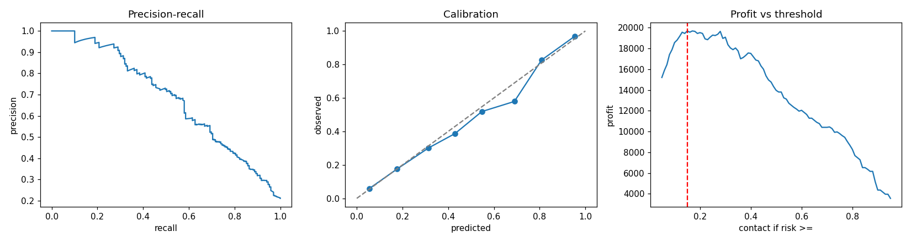

# Retention Radar: bank churn predictor

An end-to-end churn project: reproducible training, honest evaluation, a business-cost decision rule, a tested API, drift monitoring, a fairness audit, experiment tracking, Docker, CI and a deployed demo, with a custom radar-style interface.

**Live demo:** _add your Space or Render URL here after deploying_ &nbsp;|&nbsp; [Model card](MODEL_CARD.md) &nbsp;|&nbsp; [Fairness audit](reports/fairness.md)

Dataset and idea from [Soumilgit/XYZ-Bank-Customer-Churn-Predictor](https://github.com/Soumilgit/XYZ-Bank-Customer-Churn-Predictor) (MIT licence). The code here is a fresh implementation.

## Results (real data, 3,999 customers, 21.2% churn)
5-fold cross-validation on the training split:

| Model | AUC | PR-AUC | F1 |
| --- | --- | --- | --- |
| Logistic Regression | 0.8228 ± 0.0224 | 0.5704 | 0.5621 |
| Random Forest | 0.8467 ± 0.02 | 0.6415 | 0.5927 |
| Hist Gradient Boosting | 0.84 ± 0.029 | 0.6487 | 0.5793 |

Selected by PR-AUC (better than accuracy for an imbalanced target): **Hist Gradient Boosting**, then isotonic-calibrated.
Hold-out (20%, touched once): AUC 0.8382, PR-AUC 0.6813, Brier 0.1109.
At the cost-optimised threshold of 15% risk: recall 0.8047, precision 0.4198.
Assuming an offer costs 40, a customer is worth 800 and 30% accept: profit **19,680** versus 8,560 for contacting everyone and 0 for no outreach.
Top drivers (permutation importance): Age, NumOfProducts, IsActiveMember, Geography.
Generated from artifacts/metrics.json (trained 2026-10-09 10:15:22, sklearn 1.8.0, seed 42).

> Results depend on the scikit-learn version, so `requirements.txt` pins `scikit-learn==1.8.0`. To refresh this section after retraining: `python -m churn.report`.

## Data science side
- `notebooks/analysis.py` (cells) and `analysis.ipynb`: EDA, imbalance, CV comparison, PR curve, calibration, profit curve, permutation importance and SHAP, conclusions. Figures land in `reports/figures/`.
- Leakage control: `RowNumber`, `CustomerId`, `Surname` are never features.
- **Fairness audit** (`python -m churn.fairness` -> `reports/fairness.md`): selection rate, precision, recall and false-positive rate by country, gender and age band on the hold-out. Headline: outreach rates track base churn, which differs a lot by age band (see the report and model card).
- Limitations: one dataset snapshot (no time split), assumed business costs. See `MODEL_CARD.md`.

## ML engineering side
| Piece | Where |
| --- | --- |
| Schema and validation | `churn/data.py` |
| Training: CV, calibration, threshold, artifact, metrics, seed and data hash | `churn/train.py` -> `artifacts/` |
| Experiment tracking (optional MLflow) | `churn/tracking.py`, `python -m churn.train --mlflow` |
| Drift (PSI) | `churn/drift.py`, returned by `/api/batch` |
| Fairness audit | `churn/fairness.py` |
| API: `/api/predict`, `/api/batch`, `/api/health`, `/api/meta` | `app.py` |
| Tests (12, ~30 s) | `tests/` |
| Container and CI (tests, model-quality gate, Docker smoke test) | `Dockerfile`, `.github/workflows/ci.yml` |
| Deployment | `deploy/huggingface/`, `render.yaml` |

The model trains once (`python -m churn.train`) and is loaded from `artifacts/model.joblib` at serve time.

## Run
    python -m venv .venv ; source .venv/bin/activate        (Windows: .venv\Scripts\activate)
    pip install -r requirements-dev.txt
    python -m churn.train      # trains, writes artifacts/
    python app.py             # http://localhost:5000
    python -m pytest -q
    docker build -t retention-radar . && docker run -p 7860:7860 retention-radar   # http://localhost:7860

Batch scoring: upload a CSV with the 10 feature columns in the UI, or `curl -X POST --data-binary @file.csv -H "Content-Type: text/csv" localhost:5000/api/batch`.

### Experiment tracking
    pip install -r requirements-mlflow.txt
    python -m churn.train --mlflow
    mlflow ui                  # compare runs: params, hold-out metrics, CV leaderboard, artifacts

### Deploy
- **Hugging Face Spaces (recommended):** create a blank Docker Space, then `deploy/huggingface/push.sh <user>/<space>`.
- **Render:** New > Blueprint > select this repo (uses `render.yaml`). The free plan sleeps when idle.

Educational project, not for real lending or account decisions.
